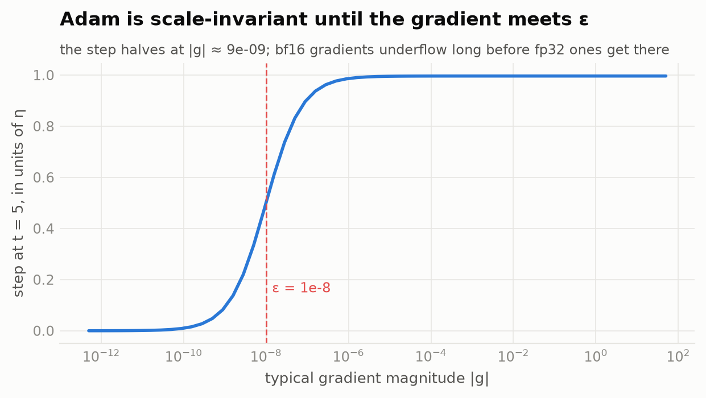
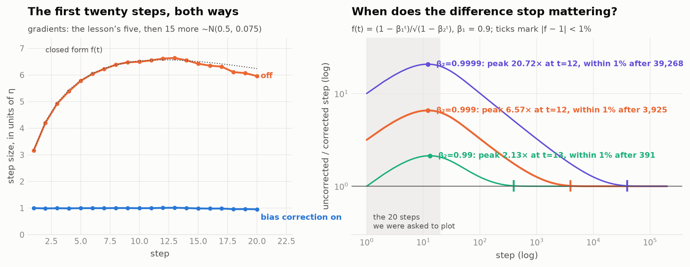
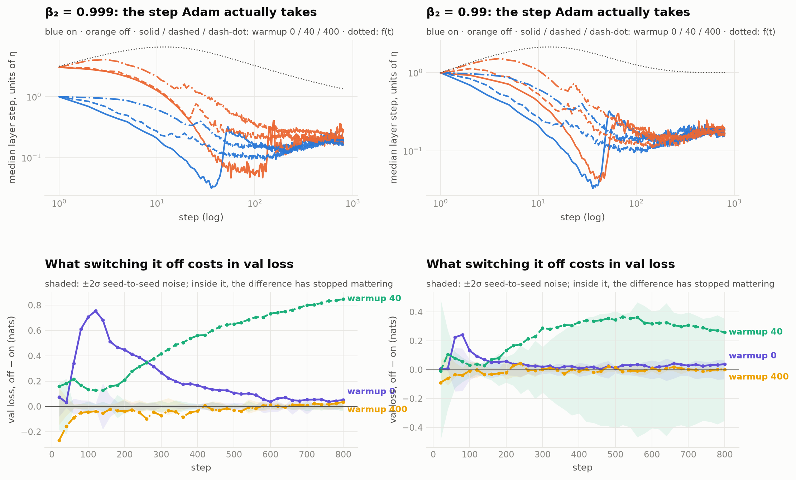
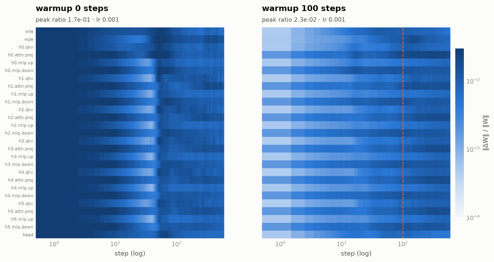
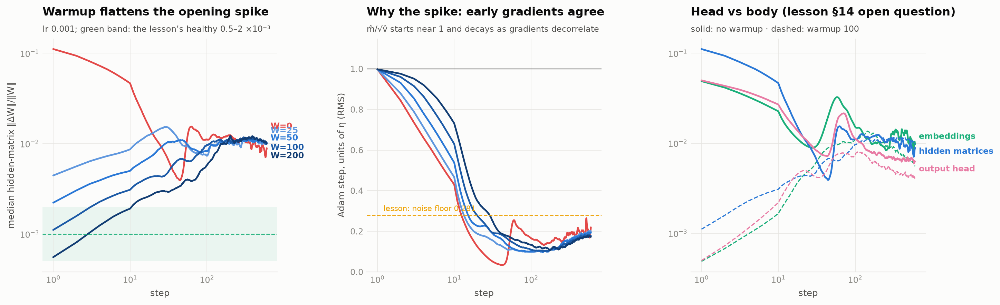
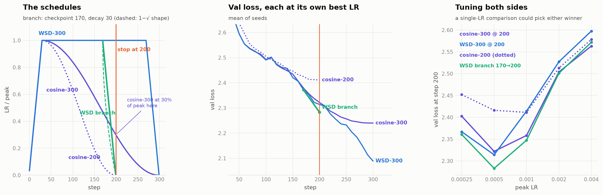
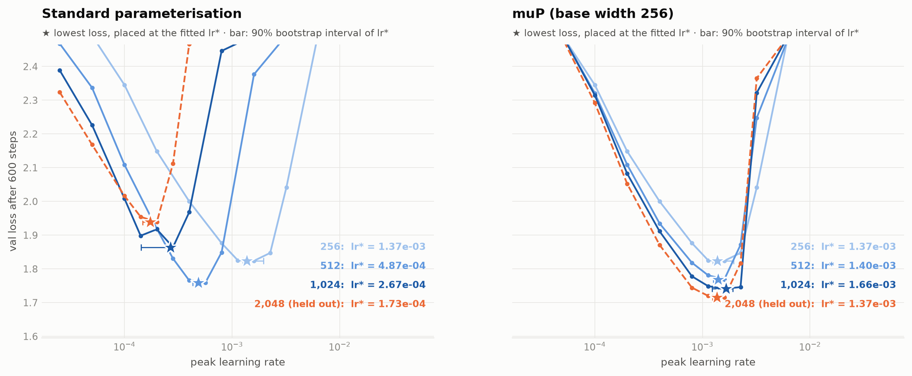
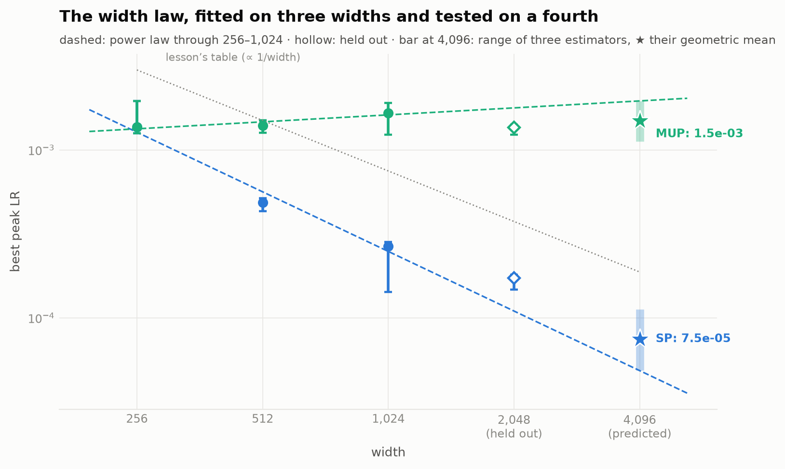
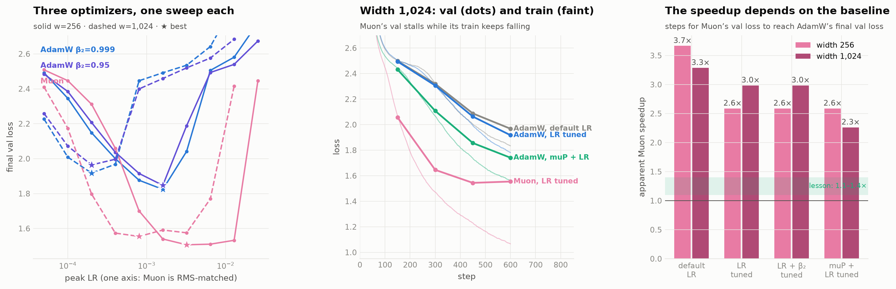

# Optimizer Claims, Re-measured

**ERA V5 · Session 11: Optimizers and Learning-Rate Schedules**

The lesson ends with a warning: *"Tune both sides before accepting a comparison. Almost every optimizer claim that failed to replicate was a well tuned method measured against a badly tuned one."* I took that seriously. Each part of the assignment became a small study: what the lesson claims, what I expected, what I ran, what I found, and what surprised me. Where a first answer turned out to depend on a badly tuned baseline or a poor measurement, I say so and show what changed.

Everything runs on the Session 10 model, a character-level GPT trained on TinyShakespeare, as the brief asks. The results come from **408 training runs, about 1.6 A100-hours on Modal**. Every number below is printed by a cell in the notebook, which reads it from the stored record of each run.

- **Notebook:** [`optimizers_and_schedules.ipynb`](optimizers_and_schedules.ipynb), executed, with every figure and table.
- **Interactive companion page:** [sourav-dhar.github.io/era-v5-s11-optimizers](https://sourav-dhar.github.io/era-v5-s11-optimizers/). You can step through Adam with your own gradients, slide β₂, hover any layer at any step of training, switch between SP and muP, and see how Muon's lead changes as the AdamW baseline improves. Every chart on it is drawn from the same result files.
- **Code:** [`s11/`](s11) holds the model, optimizers, schedules, training loop and analysis. [`tools/`](tools) holds the Modal runner and the notebook build. [`tests/`](tests) holds 7 checks.

---

## Short answers

| The brief asks | What I found | § |
|---|---|---|
| Reproduce Adam by hand and check it against PyTorch | m, v, m̂, v̂ and the step match `torch.optim.Adam` to the last digit in fp64, for every PyTorch implementation. In fp32 the optimizer state matches to 7 digits but the step only to about 5. I also reproduced a real weight inside the GPT, including steps Adam takes when the gradient is exactly zero. | [1](#1-adam-by-hand) |
| Turn bias correction off, plot 20 steps, and say when the difference stops mattering | It never stops mattering within 20 steps. The extra step is 3.16× at step 1, grows to 6.57× at step 12, and is still 6.24× at step 20. It takes 3,925 steps to fall within 1% at β₂ = 0.999. In the real model, a short warmup made it worse rather than hiding it. | [2](#2-switching-bias-correction-off) |
| Log the update-to-weight ratio for every layer and find when warmup stops changing it | Every run settles near a ratio of 1e-2. With any warmup of 100 steps or less, the ratio gets there around steps 150–170, whatever the warmup length. A 200-step warmup gets there at step 186. Without warmup the first steps are 17× too large and the run never recovers. | [3](#3-the-update-to-weight-ratio-per-layer) |
| Train with cosine and with WSD for 300 steps, stop both at 200, and pick one | At step 200 they tie (2.322 vs 2.314). I would keep the WSD run. A short decay from its step-170 checkpoint gives 2.283 for the same compute, and carried on to step 300 it reaches 2.089, against 2.240 for cosine. | [4](#4-cosine-vs-wsd-stopped-at-step-200-of-300) |
| Sweep the learning rate at widths 256, 512 and 1,024, and give a value for 4,096 with a confidence | Under the standard parameterisation: about 7.5e-5, with low-to-moderate confidence, because my fitted trend missed a fourth width I had held back by 1.6×. Under muP: 1.6e-3, with high confidence. It was the best learning rate at every width I tried. | [5](#5-how-the-best-learning-rate-moves-with-width) |
| Tune both sides before accepting a comparison | AdamW vs Muon, with the AdamW baseline tuned progressively more carefully. At width 1,024 Muon's apparent speedup falls from 3.3× to 2.3×, and switching AdamW to muP alone removes about half of Muon's advantage. | [6](#6-adamw-vs-muon-both-tuned) |

---

## Setup

| | |
|---|---|
| Model | The Session 10 GPT: pre-norm transformer blocks, learned positions, GELU MLP, untied output head. Parts 1–4 use the Session 10 size, 6 layers × 384 wide (10.8M parameters). Parts 5–6 use 4 layers at widths 256 to 2,048 (3.3M to 202M parameters) with the head dimension fixed at 64. |
| Data | TinyShakespeare, one token per character (65 symbols), split 90/10. Each batch is fixed by its seed and step number, so every schedule sees the same data. |
| Training | Batch 32 × 256 tokens, bf16 autocast, gradient clipping at 1.0, AdamW with β = (0.9, 0.999) as in the lesson unless stated. Validation loss is always measured on the same 131k held-out tokens. |
| Compute | Modal A100-40GB, up to 8 at once. Runs are cached by their configuration, so a run shared by two studies is only trained once. |
| Seeds | 2 for every configuration, 3 in the schedule study. Tables report the spread across seeds. |

**Checks.** [`tests/test_core.py`](tests/test_core.py) confirms seven things:
- The lesson's §6 table, digit for digit.
- The closed form for the bias-correction error.
- My hand-written AdamW matches `torch.optim.AdamW` to within 1e-14 after 25 steps.
- My Muon matches `torch.optim.Muon` exactly.
- muP and SP produce the identical model at the base width.
- On step 1 the median layer moves 1.00 η with bias correction and 3.16 η without.
- A WSD decay taken from a checkpoint gives exactly the same model as a run planned for that length. That test exists because of a bug I hit, described [below](#what-went-wrong-on-the-way).

---

## 1 · Adam, by hand

**The claim (lesson §6):** with bias correction, Adam moves every weight by roughly η, whatever the size of its gradient.

I wrote the update out in a few lines of plain Python ([`adam_by_hand`](s11/optim.py)) and ran the lesson's example: one weight starting at 1.0, the gradients 0.50, 0.40, 0.60, 0.45 and 0.55, and η = 0.001. PyTorch doesn't store m̂ and v̂, so for the comparison I read m, v and the step count out of its optimizer state and applied the same definitions.

| t | g | m | v | m̂ | v̂ | step | w |
|--:|--:|--:|--:|--:|--:|--:|--:|
| 1 | 0.50 | 0.050000 | 0.000250 | 0.500000 | 0.250000 | −0.001000 | 0.999000 |
| 2 | 0.40 | 0.085000 | 0.000410 | 0.447368 | 0.204977 | −0.000988 | 0.998012 |
| 3 | 0.60 | 0.136500 | 0.000769 | 0.503690 | 0.256703 | −0.000994 | 0.997018 |
| 4 | 0.45 | 0.167850 | 0.000971 | 0.488078 | 0.243132 | −0.000990 | 0.996028 |
| 5 | 0.55 | 0.206065 | 0.001273 | 0.503199 | 0.255030 | −0.000996 | 0.995031 |

The gradient varies by ±20% across the five steps, yet every step stays within 1.2% of η.

**How closely PyTorch agrees, in decimal digits.** 16 means agreement down to the last digit fp64 can hold.

| implementation | fp64: m, v, m̂, v̂, w | fp64: step | fp32: m, v, m̂, v̂, w | fp32: step |
|---|--:|--:|--:|--:|
| `torch.optim.Adam` (for-loop, foreach and fused) | 16.0 | 16.0 | 7.1 | 4.9 |
| `torch.optim.AdamW` with λ = 0 | 16.0 | 16.0 | 7.1 | 4.9 |
| my `HandAdamW` | 16.0 | 16.0 | 7.1 | 4.9 |

How many decimal places "agree" depends on what you compare. In fp32 the optimizer's stored numbers agree to about 7 digits, but the step only to about 5. The step is the difference between the weight before and after, and fp32 numbers near 1.0 are only about 6e-8 apart, so a step of 0.001 keeps just 4–5 significant digits. This is the precision problem from Session 10 again, and it is the reason the master copy of the weights is kept in fp32.

**A real weight, and Adam moving without a gradient.** The lesson's gradients are made up, so I also took two real embedding weights from the GPT and recorded their actual gradients over five AdamW steps:
- **The space character**, the most common character in the text.
- **The letter 'q'**, which appears in the first batch and in none of the next four.

My hand calculation in fp64 matches PyTorch, running the model in fp32, to within 2.2e-9. The interesting part is 'q'. Its gradient is exactly zero on steps 2 to 5, but it still moves by 0.67, 0.52, 0.42 and 0.36 η. Adam's running average m still remembers step 1, and it fades faster than v does, so m̂/√v̂ stays above zero. That is useful for a rare token, but it also means a weight keeps moving after its gradient has stopped.



**Where "whatever the size of its gradient" stops holding.** Multiplying all five gradients by the same factor leaves Adam's step unchanged, until the gradients become as small as ε = 1e-8. At |g| ≈ 9e-9 the step is already half of η.

---

## 2 · Switching bias correction off

**The claim (lesson §6):** bias correction matters most at the first step, where it turns a 3.16η step into 1.00η.

**What I expected.** For a steady gradient, the step without correction is the corrected step multiplied by **f(t) = (1 − β₁ᵗ) / √(1 − β₂ᵗ)**. The top recovers within about 10 steps (β₁ = 0.9), but the bottom takes about 1,000 steps (β₂ = 0.999). So the error should grow after step 1 before it shrinks, which would make step 1 the smallest error of the early steps rather than the largest.



| β₂ | largest extra step | at step | at step 20 | within 10% after | within 1% after | extra distance over the first 1,000 steps |
|--:|--:|--:|--:|--:|--:|--:|
| 0.99 (used in Session 10) | 2.13× | 13 | 2.06× | 175 steps | 391 steps | 83 η |
| 0.999 (the lesson's value) | 6.57× | 12 | 6.24× | 1,751 steps | 3,925 steps | 997 η |
| 0.9999 | 20.7× | 12 | 19.7× | 17,512 steps | 39,268 steps | 4,831 η |

**My answer to the question.** Within the first twenty steps the difference never stops mattering. After 20 steps the uncorrected weight has moved 99 η further than the corrected one. How long the error lasts depends on β₂, not on the length of the training run.

**Does warmup hide the missing correction?** During warmup the learning rate is small exactly when the error is largest, so a run without bias correction could look normal. The formula suggests a sharper test: warmup can only hide the problem if it lasts longer than β₂'s memory, 1/(1−β₂) steps. I trained the GPT with my hand-written AdamW, with bias correction on and off, with warmups of 0, 40 and 400 steps, and with β₂ of 0.999 and 0.99. That is 2 seeds and 800 steps each.



| β₂ (memory) | warmup | val loss lost by turning correction off, at step 800 |
|---|--:|--:|
| 0.99 (about 100 steps) | 0 | 0.039 |
| 0.99 | 40 | 0.258 |
| 0.99 | 400 | **0.002**: hidden |
| 0.999 (about 1,000 steps) | 0 | 0.052 |
| 0.999 | 40 | **0.849**: the worst case |
| 0.999 | 400 | 0.035: partly hidden |

The prediction held, with a twist I did not expect: **a short warmup is worse than none.** When a 40-step warmup ends, f(40) = 5.0, so the uncorrected run is effectively training at five times the learning rate. That is too high for this model to get off its loss plateau. The uncorrected run stays stuck at about 2.5 while the corrected run reaches about 1.68. With no warmup, both runs get stuck early, so the gap looks small, which makes the broken optimizer look better than it is.

---

## 3 · The update-to-weight ratio, per layer

**The claim (lesson §9):** at the start of training, gradients all point the same way, so Adam takes its largest possible step on every weight at once. Warmup stops the ratio ‖ΔW‖/‖W‖ from starting far above a healthy level.

**What I ran.** AdamW with a warmup of 0, 25, 50, 100 or 200 steps followed by a constant learning rate, at peak learning rates of 1e-3 and 3e-3, 2 seeds, 600 steps. At every step I logged ‖ΔW‖/‖W‖ for all 27 weight matrices, and also the size of Adam's own step in units of η, leaving out weight decay.




**How I decide when warmup "stops changing" the ratio.** All runs end up at about the same ratio. For each layer I take that shared late level, then find the first step after which the layer's ratio (a 25-step rolling median) stays within ±25% of it, allowing no more than 10% of later steps outside that band. After that step, someone looking only at the ratio could not tell how long the warmup was. My first definition compared each run against the no-warmup run. It did not work: the no-warmup run fails (see below), and the ratio naturally jumps around by about ±20% from step to step.

| warmup | ratio settles at step (median layer) | as a multiple of the warmup | highest ratio | val loss at step 600 |
|--:|--:|--:|--:|--:|
| 0 | 427 | — | 0.173 | 2.505 (stuck) |
| 25 | 148 | 5.9 | 0.033 | 1.834 |
| 50 | 167 | 3.3 | 0.024 | 1.773 |
| 100 | 168 | 1.7 | 0.023 | **1.746** |
| 200 | 186 | 0.93 | 0.026 | 1.757 |

**My answer.** At a learning rate of 1e-3, warmup stops affecting the ratio at around step 150–170 for any warmup of 100 steps or less. Short warmups end with the ratio overshooting, and it takes another 70–120 steps to settle. A 200-step warmup settles at 0.93× its length, a little before the warmup finishes. By step 150, Adam's own step has already shrunk from 1.00 η to about 0.11 η, so the full learning rate is no longer needed to reach the plateau.

**Where my numbers differ from the lesson:**
- **The ratio settles near 1e-2, not the lesson's 1e-3.** As a rough check, the ratio is about η × (Adam's step in units of η) ÷ (weight size), which here is 1e-3 × 0.18 ÷ 0.02 ≈ 9e-3. The lesson's 1e-3 refers to its own, much wider model trained with η = 3e-4.
- **Adam's late step is 0.18 η**, below the 0.281 η the lesson measured on random noise. The real gradients here are even less consistent from step to step.
- **Without warmup, training simply fails.** The model sits on a loss plateau around 2.5 for all 600 steps, while every warmed-up run gets past it. At a learning rate of 3e-3, no amount of warmup saves the run.
- **The output head versus the rest (an open question in lesson §14).** In the 100-step warmup run, the head's ratio ends at 0.42× that of the hidden layers. The head is moving relatively little, which, if anything, suggests it could use a higher learning rate, not a lower one.

---

## 4 · Cosine vs WSD, stopped at step 200 of 300

**A catch in the question.** By step 200, a cosine schedule planned for 300 steps has already lowered its learning rate to 30% of its peak, while WSD hasn't started lowering its learning rate at all. Stopping both at step 200 therefore mostly tells you which one has decayed. So I looked at every model I could realistically hand over at step 200. Each was trained at its own best peak learning rate, from 2.5e-4 to 4e-3, with 3 seeds.



| model at step 200 | steps of training | val loss |
|---|--:|--:|
| constant learning rate, with an average of the weights (EMA 0.9) | 200 | **2.281 ± 0.009** |
| WSD with a decay from its step-170 checkpoint (linear) | 200 | **2.283 ± 0.011** |
| WSD with a decay from its step-170 checkpoint (1 − √) | 200 | 2.291 ± 0.008 |
| WSD planned for 300, stopped at 200 | 200 | 2.314 ± 0.007 |
| cosine planned for 300, stopped at 200 | 200 | 2.322 ± 0.011 |
| cosine planned for exactly 200 | 200 | 2.411 ± 0.041 |
| *WSD with a decay from its step-200 checkpoint* | *230 / 260* | *2.224 / 2.175* |
| *WSD, full 300 steps* | *300* | *2.089* |
| *cosine, full 300 steps* | *300* | *2.240* |

**Which model I would keep: the WSD run.**
- Stopped at step 200, the two are level (a difference of 0.008, within seed-to-seed variation).
- With the same 200 steps, a short decay from WSD's step-170 checkpoint beats every cosine model.
- A cosine planned for exactly 200 steps did worst of all. This early in training the model is still escaping its loss plateau, and lowering the learning rate early costs more than it gains.
- The WSD run can keep going: by step 300 it reaches 2.089, against 2.240 for cosine.

**Two more observations.**
- Keeping the learning rate constant and averaging the weights gives the same result as WSD's decay, without decaying at all. That matches the 2026 result the lesson mentions, here at 10M parameters.
- The winner depends on the learning rate. At 1e-3, cosine is ahead of WSD at step 200 (2.358 vs 2.414). At 5e-4, WSD is slightly ahead. Compare the two at a single learning rate and you can get either answer, which is the brief's warning in action.

---

## 5 · How the best learning rate moves with width

**The claim (lesson §12):** under the standard parameterisation (SP) the best learning rate falls roughly as 1/width. Under muP it stays the same.

**What I ran.** A 4-layer GPT at widths 256, 512 and 1,024, trained twice:
- **SP:** the Session 10 architecture and initialisation.
- **muP:** relative to width 256, hidden weights are initialised smaller, hidden layers get a proportionally smaller Adam learning rate, and the output is scaled down by the width ratio.

The sweep covered 12 learning rates from 2.5e-5 to 5.1e-2, each double the last, with 600 steps and 2 seeds. After the first pass I added points at ×√2 either side of each best value. The loss rises very sharply just above the best learning rate, so the doubling grid was too coarse to locate it. I also trained a fourth width, 2,048, but left it out of the fit. That let me test the prediction before saying anything about 4,096.




| width | SP best LR | SP val loss | muP best LR | muP val loss |
|--:|--:|--:|--:|--:|
| 256 | 1.37e-3 | 1.824 | 1.37e-3 | 1.824 |
| 512 | 4.87e-4 | 1.759 | 1.40e-3 | 1.769 |
| 1,024 | 2.67e-4 | 1.864 | 1.66e-3 | 1.741 |
| 2,048 (held out) | 1.73e-4 | 1.939 | 1.37e-3 | **1.715** |

**SP.** A straight line in log space through widths 256 to 1,024 has slope −1.18, close to the lesson's −1. It predicted 1.1e-4 for width 2,048, but the measured best was 1.73e-4. That is 1.58× higher and outside the line's uncertainty band. The seed-to-seed uncertainty was small. The real uncertainty is whether a straight line is the right shape at all, and only the held-out width revealed that. Between 1,024 and 2,048 the slope flattens to −0.63. For 4,096, three reasonable ways of extending the trend give:

| method | learning rate at 4,096 |
|---|--:|
| line fitted to 256–1,024 | 4.8e-5 |
| line fitted to all four widths | 7.6e-5 |
| the 1,024 → 2,048 slope, extended | 1.1e-4 |

**I would use about 7.5e-5** (the geometric mean of the three) **with low-to-moderate confidence**, expecting the true best to lie within about 1.5× either way. Before committing to a long run I would test 0.5×, 1× and 2× that value at width 4,096.

**muP.** The fitted best value moves around between 1.4e-3 and 1.7e-3, but only because the bottoms of the muP curves are flat. A more useful question is whether a single learning rate works at every width. It does: **1.6e-3 gave the lowest loss at every width from 256 to 2,048**, and the next-best value is never more than 0.012 worse. Under SP, the best single learning rate is 0.32 worse than the best at one of the widths. **For width 4,096 under muP, I would use 1.6e-3 with high confidence.** The hidden layers then receive it scaled by 256/4,096, as muP prescribes.

**A claim my data only partly supports.** The lesson says muP "does not improve the model." At width 512 the two versions are level within noise. At 1,024 and 2,048, muP is better by 0.12 and 0.22. Under SP, the wider models actually do worse than width 512 within this budget, while under muP every doubling of width helps. My guess, which I have not tested: with a fixed initialisation scale and no output scaling, the wide SP models start out taking updates that are too large, and 600 steps isn't enough to recover.

---

## 6 · AdamW vs Muon, both tuned

**The claim (lesson §13):** Muon beats a well-tuned AdamW by about 1.4× at 0.1B parameters and 1.1× at 1.2B. The two-fold claims came from untuned baselines.

**What I ran.** Muon handles the hidden weight matrices and AdamW handles everything else, as in published setups. Muon's update is scaled to match AdamW's size (×0.2√max(A, B), following Liu et al. 2025), so both use the same learning-rate scale. I compared four setups at widths 256 and 1,024, each at its own best learning rate:
- **AdamW with β₂ = 0.999**, the lesson's default.
- **AdamW with β₂ = 0.95**, a common choice for language models.
- **AdamW under muP**, taken from the §5 sweep.
- **Muon.**

The first, second and fourth used the same 10-point learning-rate sweep with 2 seeds. Speedup is 600 ÷ the step at which Muon's validation loss reaches the baseline's final validation loss.



| width | AdamW, LR tuned | AdamW, β₂ = 0.95 | AdamW, muP | Muon | speedup vs AdamW at a default LR | vs LR-tuned AdamW | vs muP AdamW |
|--:|--:|--:|--:|--:|--:|--:|--:|
| 256 | 1.824 | 1.847 | 1.824 | **1.507** | 3.7× | 2.6× | 2.6× |
| 1,024 | 1.917 | 1.964 | 1.741 | **1.555** | 3.3× | 3.0× | **2.3×** |

The "default LR" baseline is AdamW at 4e-4, the grid point closest to the common default of 3e-4.

**All of these speedups come from the same Muon runs. Only the baseline changes.**
- β₂ = 0.95 was slightly worse for AdamW here, so it changed nothing.
- Moving AdamW to muP cut Muon's lead at width 1,024 from 0.36 to 0.19 in validation loss. **About half of Muon's apparent advantage was really a problem with how AdamW was parameterised.** That makes sense: Muon's update already adjusts for the shape of each weight matrix, much as muP does, so comparing Muon with SP AdamW changes two things at once. At width 256 the muP and SP models are identical, so that bar does not move.
- What remains, 2.3–2.6×, is still more than the lesson's 1.1–1.4×. Those figures come from models of 0.1–1.2B parameters trained for a long time. These are 3–50M-parameter models trained for 600 steps, most of that spent getting off the loss plateau, and I did not tune AdamW's warmup or ε. I read the remaining gap as an upper bound for small models on short runs, not as evidence against the lesson.

**Why I used validation loss rather than training loss.** At width 1,024, Muon's training loss ends 0.49 below its validation loss. 600 steps × 8,192 tokens is about five passes over TinyShakespeare's million characters, and Muon begins to memorise it: its validation loss rises slightly between steps 450 and 600. A speedup measured on training loss would partly reward that memorisation.

---

## What went wrong on the way

These changed my results, so they are part of the work.

1. **A bug that froze the learning rate.** In my first schedule run, a 1 − √ decay branch gave exactly the same loss as WSD stopped at step 200, which should be impossible. Restoring the optimizer after a branch (`load_state_dict`) replaces its internal parameter groups, and my code kept setting the learning rate on the old copies, so the learning rate stayed stuck at its peak. I fixed it, added a test that a branch must match a separately planned run exactly, and reran the study.
2. **My first ratio definition measured noise.** Comparing against the no-warmup run never settled, because that run fails and the ratio is noisy. I switched to the shared-plateau definition in §3.
3. **I first tuned only AdamW's learning rate,** and Muon looked about 3× better. That is exactly the kind of baseline the lesson warns about, so I added the β₂ and muP versions. The muP version halved the gap.
4. **I first measured speedup on training loss,** which partly measured Muon memorising the data. I switched to validation loss.
5. **My first learning-rate grid was too coarse** for curves that rise this steeply. The extra ×√2 points moved several of the best values and changed the 4,096 estimate under SP.
6. **My first schedule runs used a 15-step warmup.** Results varied by up to ±0.05 between seeds, and §3 showed this model is very sensitive to warmup. I reran with 30 steps.

## A note on the lecture

At one point in the live class, bias correction is described as "what AdamW is doing … to make sure that it is not getting affected by the weight decay." These are two separate fixes. Bias correction belongs to Adam: it corrects m and v for starting at zero, with the error shown in §2. Decoupled weight decay is what AdamW adds, taking the λw term out of the gradient so that √v̂ doesn't divide it. I followed `lesson.md`, which describes both correctly.

## Limitations

- These are small models (3M–202M parameters), trained on a one-million-character dataset for 200–800 steps. Several effects depend on this model's loss plateau at about 2.5, which large models on real text don't have in the same form.
- Most results use 2 seeds and the schedule study uses 3. Differences smaller than about 0.02 should be treated as ties.
- muP follows the Adam rules from Tensor Programs V (Yang et al., 2022) with the head dimension fixed at 64. I only varied width, not depth.
- AdamW's warmup length and ε were not tuned in §6, so the remaining Muon advantage is an upper bound.

## Reproducing this

```bash
pip install -r requirements.txt
python -m pytest -q tests                                  # 7 checks, CPU, under a minute
modal run tools/modal_app.py --study all                   # every study on A100s, about 1.6 GPU-hours, resumable
python tools/build_notebook.py                             # builds the notebook from tools/notebook_cells.md
python tools/run_notebook.py --profile full --out optimizers_and_schedules.ipynb
python tools/export_site.py --profile full                 # rebuilds the companion page from the results
python tools/run_notebook.py --profile quick               # without a GPU: a tiny CPU version of everything (numbers not meaningful)
```

```
s11/       data.py · model.py (SP and muP) · optim.py (Adam by hand, HandAdamW, Muon) · schedules.py · train.py · experiments.py · analysis.py · style.py
tools/     modal_app.py · notebook_cells.md → build_notebook.py → optimizers_and_schedules.ipynb · run_notebook.py · export_site.py
results/   <study>.full.json (full record of every run) · summary.full.json (every number quoted above)
figures/   every figure in this README
site/      the companion page source (index.src.html) · docs/  the built page served by GitHub Pages
tests/     test_core.py
```
